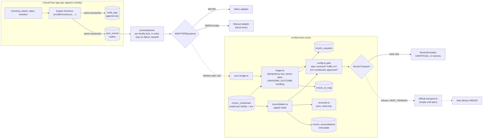

# Architecture

Dashed boxes are not active. Nothing reaches the real NMS2S today.

## Write path

1. A person adjusts a package. `adjustPackage` writes the package, the audit entry, and a `sync_events` row in one transaction.
2. `processQueue` takes the facility lock and calls the adapter for the oldest pending record.
3. The bridge maps the event to a CannaTrace write intent (`PACKAGE_ADJUST`, `PACKAGE_SPLIT`). Anything else is set aside for hand entry.
4. The ledger derives the request key from the sync event id, inserts or finds the ledger row, refuses a different body under the same key, and atomically claims it.
5. The gate checks the transport and environment. The transport is called under a time limit.
6. Outcome:
   - accepted → `ACCEPTED`, state ids linked;
   - known not applied → `RETRYABLE`;
   - refused on its merits → `REJECTED`;
   - anything that might have been applied → `UNKNOWN_OUTCOME`, which holds the facility's queue until a lookup or a person settles it.
7. Every transition is written to `audit_logs`, with credentials scrubbed.

## Read and reconciliation path

1. Credentials for this facility and environment are opened server-side.
2. All pages of packages and plants are read, with temporary errors retried. A permission or credential error stops the run, and a repeated cursor is rejected.
3. `reconcile()` compares the state's records with this facility's records only. Pending ledger rows turn would-be differences into `PENDING_OUTCOME`.
4. The counts and the non-matching findings are saved as an immutable record and audited. Proposed id links wait for a person.

## Isolation

- Every table row carries `org_id`, `facility_id` and `environment`. Each query filters on the actor's own org and facility.
- Credentials are sealed with associated data `nms2s:{org}:{facility}:{environment}`, so a sealed value copied to another row cannot be opened there.
- The transport receives one facility's license and credentials per call.
